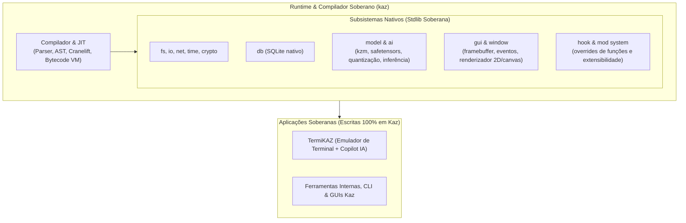
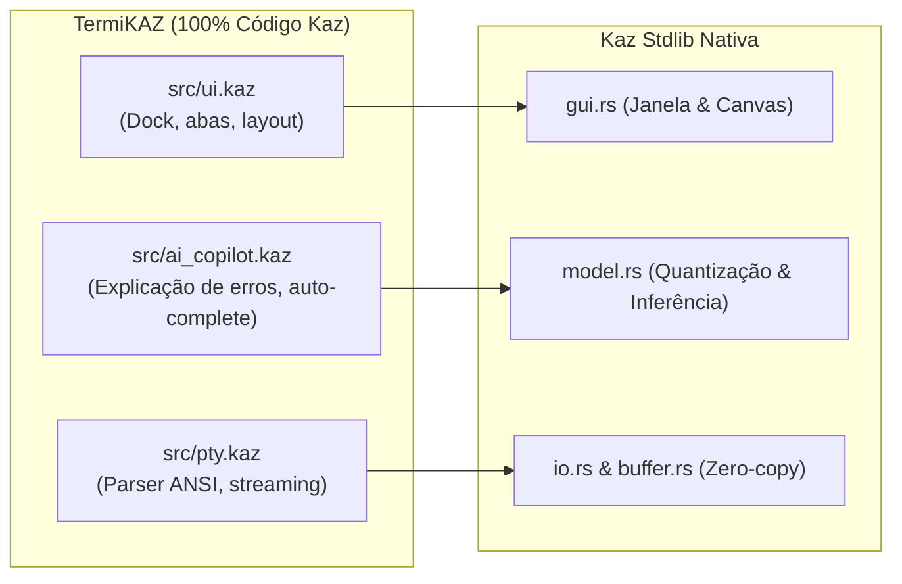

# Arquitetura Soberana do Ecossistema Kaz: Core, GUI & IA

> **Princípio Fundamental:** Autossuficiência absoluta. Zero dependências externas (`npm`, crates de terceiros, pacotes comunitários espalhados). Um único compilador/runtime soberano, extensível através do sistema de módulos e overrides estilo mods de jogos (DayZ).

---

## 1. Visão Geral da Arquitetura Unificada

Para evitar a **fadiga de sincronização** (o risco de bifurcar o projeto e uma parte ficar defasada), o **Kaz** mantém um **único compilador/runtime binário (`kaz`)**, onde I/O, Banco de Dados, Motor de Inferência/Quantização de IA e Interface Gráfica (GUI) são subsistemas nativos de primeira classe.



---

## 2. Como Ficam os Subsistemas Dentro do Kaz

Em vez de criar outro projeto ou outro compilador, o runtime ganha o subsistema **`gui`** no mesmo padrão dos módulos já existentes (`db`, `model`, `fs`):

```text
kaz/
├── src/
│   ├── main.rs                  # CLI unificada (kaz build, run, jit, term)
│   ├── parser.rs / ast.rs       # Sintaxe única e estável da linguagem
│   ├── vm/                      # Bytecode VM de alta velocidade
│   ├── jit/                     # Motor Cranelift JIT/AOT
│   └── stdlib/                  # Módulos Nativos Autossuficientes
│       ├── io.rs                # print, input, argumentos
│       ├── fs.rs                # Leitura e escrita de arquivos
│       ├── db.rs                # SQLite integrado
│       ├── model.rs             # IA: Safetensors, .kzm, tensores, quantização
│       ├── hook.rs              # Sistema de overrides / modding
│       └── gui.rs  <-- [NOVO]   # Janela nativa, framebuffer, canvas e eventos
```

---

## 3. Especificação do Subsistema `gui` Nativo

O subsistema gráfico nativo do Kaz fornece as primitivas essenciais para desenhar interfaces sem precisar de frameworks pesados de terceiros:

### Primitivas de Sistema Gráfico (Stdlib Nativa)
- `gui_window_create(title, width, height)`: Cria janela nativa do SO (Wayland/X11 no Linux, Win32 no Windows).
- `gui_poll_events()`: Retorna eventos de teclado, clique, movimento do mouse e redimensionamento.
- `gui_draw_rect(x, y, w, h, color)`: Renderização 2D de retângulos/painéis.
- `gui_draw_text(text, x, y, font_size, color)`: Renderização de texto com rasterizador de fontes embutido.
- `gui_render_frame()`: Troca os buffers (Double Buffering) com sincronização vertical (VSync).

---

## 4. O Sistema de Módulos & Overrides (Estilo DayZ)

A customização e extensibilidade do Kaz não dependem de gerenciadores de pacotes (`npm`, `pip`, etc.). Ela funciona pelo mecanismo de **Overrides e Hooks Nativos**:

```kaz
// Exemplo: mod_custom_theme.kaz
// O desenvolvedor intercepta ou estende o comportamento padrão

override fn gui_theme_background() {
    return "#1e1e2e"; // Cores customizadas injetadas diretamente
}

override fn on_ai_token_generated(token) {
    // Intercepta a saída do motor de IA em tempo real
    terminal_highlight_stream(token);
}
```

O runtime carrega os arquivos de script e aplica as tabelas de símbolos sobrescritas em tempo de compilação ou inicialização da VM.

---

## 5. Como o TermiKAZ se Encaixa Nessa Estrutura

Com essa abordagem, o **TermiKAZ** se torna o projeto modelo que valida a autossuficiência do Kaz:



### Exemplo Conceitual do TermiKAZ em Código Kaz:

```kaz
// src/main.kaz - Ponto de entrada do TermiKAZ
import gui;
import model;
import fs;

fn main() {
    let win = gui_window_create("TermiKAZ 🦅", 1024, 680);
    
    // Inicializa o motor de inferência local
    let ai_model = kzm_open("models/kaz-assistant-q4.kzm");
    
    while !gui_should_close(win) {
        let events = gui_poll_events();
        
        // 1. Processa I/O do terminal
        term_process_input(events);
        
        // 2. Renderiza abas, dock e terminal
        gui_draw_dock();
        gui_draw_terminal_grid();
        
        // 3. Atualiza tela
        gui_render_frame();
    }
}
```

---

## 6. Comparativo: Bifurcar Projetos vs. Kaz Soberano Unificado

| Critério | Bifurcação (2 Projetos Separados) | Kaz Soberano Unificado (Recomendado) |
| :--- | :--- | :--- |
| **Risco de Desatualização** | **Altíssimo:** toda melhoria na VM/IA precisa ser portada manualmente para a GUI. | **Zero:** Uma única base de código; melhorias no compilador beneficiam tudo instantaneamente. |
| **Complexidade de Build** | Dois pipelines, problemas de dependências cruzadas e versões de release. | Um único executável: `kaz build termikaz.kaz`. |
| **Filosofia de Autossuficiência** | Fraturada (o usuário precisa escolher qual versão baixar). | **100% Soberano:** O Kaz vem completo com Compilador, IA e GUI de fábrica. |
| **Tamanho da Comunidade** | Dividida entre quem usa o core e quem usa a versão GUI. | Unificada em torno de uma única linguagem forte. |

---

## 7. Próximos Passos de Implementação

1. **No repositório `kaz`:** Implementar o módulo `src/stdlib/gui.rs` com as primitivas básicas de janela e renderização direta (sem frameworks externos).
2. **No repositório `kaz`:** Expandir o suporte à quantização de tensores em `src/stdlib/model.rs` (Q4/Q8).
3. **No repositório `TermiKAZ`:** Escrever a lógica do terminal (abas, dock, PTY, copilot) em arquivos `.kaz`, consumindo os módulos nativos do Kaz.
